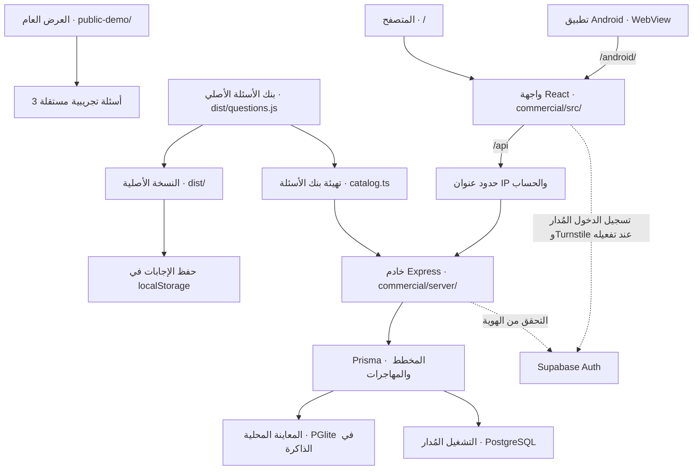

# مَوَدّة — Mawadda

مشروع تعارف وحوار قبل الزواج: 150 سؤالًا، 15 محورًا، إجابات منفصلة ومقارنة.

## تشغيل النسخة الأصلية
يتطلب Node.js 20 أو أحدث. لا توجد مكتبات خارجية أو خطوة تثبيت.

```sh
npm run dev
```
افتح http://127.0.0.1:3000

```sh
npm test
npm run check
```

## معاينة النسخة التجارية

تطبيق React وTypeScript مع خادم Express داخل `commercial/`. استخدم Node.js 22.12 أو أحدث على خط 22، أو Node.js 24 فأحدث. يحفظ الخادم نسخة من بنك الأسئلة الكامل ويثبّت إصدارها لكل جلسة.

```sh
cd commercial
npm ci
npm run dev
```

افتح `http://127.0.0.1:3001`. ادخل باسم رنا، وأنشئ جلسة، ثم ادعُ `omar@example.test` من صفحة «الطرف الآخر». افتح رابط الدعوة في تبويب جديد وادخل باسم عمر. استخدم اسم نور لاختبار حساب خارج الجلسة. بيانات المعاينة مؤقتة وتُمسح عند إعادة تشغيل الخادم.

التفاصيل وأوامر الفحص وإعداد PostgreSQL وSupabase في [دليل النسخة التجارية](commercial/README.md).

## إصدار أندرويد

نسخة أندرويد لها شاشة حساب وملف شخصي، ولوحة لإدارة المستخدمين تظهر للأدمن. راجع [دليل بناء الـAPK وتشغيله](android/README.md).

## حماية الأسئلة والـAPI

- **بنك الأسئلة التجاري.** يتحقق الخادم من هوية المستخدم وعضويته في الجلسة قبل إرجاع أسئلة محور واحد. الحساب العادي يقدر يفتح حتى 6 محاور مختلفة خلال 5 دقائق عبر كل جلساته. إعادة فتح المحور من نفس الإصدار ضمن الفترة تستخدم نفس الحصّة.
- **حدود الطلبات.** يطبّق الخادم حدودًا حسب الحساب وعنوان IP، وحدودًا أشدّ لإنشاء الجلسات والدعوات. عند التجاوز يرجع `429` مع `Retry-After`، وتعرض الواجهة مدة الانتظار. حصة المحاور محفوظة في قاعدة البيانات، والحدود العامة تعمل لكل عملية خادم.
- **العرض العام.** مجلد [public-demo/](public-demo/index.html) فيه ثلاثة أسئلة تجريبية مستقلة. انشر هذا المجلد وحده للعرض العام. النسخة الأصلية في `dist/` ترسل بنكها كاملًا للمتصفح وتناسب التشغيل المحلي.
- **قبل تشغيل التحديث على قاعدة فعلية.** شغّل `npm run migrate` من `commercial/` لإضافة جدول `CategoryAccess`. حماية DDoS تتطلب ربط النطاق بـCloudflare. CAPTCHA يتطلب ضبط مفتاح الموقع في التطبيق وتفعيل Turnstile في Supabase Auth. [دليل الحماية والنشر](commercial/README.md#حماية-الأسئلة-والـapi-عند-النشر)

## البدء في Codex
افتح هذا المجلد كمشروع محلي. اقرأ PROJECT.md وAGENTS.md قبل التعديل.
رسالة مقترحة: «اقرأ PROJECT.md وAGENTS.md، شغّل الاختبارات، ثم راجع المشروع واقترح أول مرحلة لتحويله إلى منصة حقيقية دون تغيير البيانات أو نشر تغييرات.»

## معمارية المشروع



تستخدم النسخة الأصلية ملف `dist/questions.js` مباشرة. يقرأه الخادم التجاري عند التهيئة ويحفظه كإصدار من الاستبيان. كل جلسة تجارية ترتبط بإصدار واحد، وتبدأ الجلسات الجديدة على آخر إصدار منشور. يبني Vite واجهة React في `commercial/build/client/`، ويعرضها Express على `/` و`/android/`. يفتح تطبيق أندرويد المسار الثاني داخل WebView.

## شجرة الملفات

```text
mawadda/
├── README.md                         دليل التشغيل والمعمارية
├── PROJECT.md                        وصف النسخة الأصلية وخطة التطوير
├── AGENTS.md                         تعليمات المساهمة والاختبارات
├── package.json                      أوامر تشغيل وفحص النسخة الأصلية
├── mawadda.code-workspace            مساحة عمل اختيارية لـ VS Code
├── test.cjs                          اختبارات الأسئلة والتقييم والاستيراد
├── scripts/
│   └── serve.cjs                     خادم المعاينة الأصلية على المنفذ 3000
├── dist/                             ملفات مصدر النسخة الأصلية
│   ├── index.html                    هيكل الواجهة العربية
│   ├── style.css                     التنسيق المتجاوب والطباعة
│   ├── questions.js                  المحاور وبنك الأسئلة والخيارات
│   └── app.js                        الإجابة والمقارنة والحفظ والاستيراد والتصدير
├── public-demo/                      عرض عام مستقل بثلاثة أسئلة تجريبية
│   ├── index.html                    هيكل العرض القصير
│   ├── demo.css                       تنسيق العرض القصير
│   └── demo.js                        الأسئلة التجريبية والتنقّل وعرض الاختيارات
├── commercial/
│   ├── README.md                     تشغيل النسخة التجارية وإعداد خدماتها
│   ├── package.json                 أوامر البناء والفحص والتشغيل والمهاجرات
│   ├── package-lock.json            إصدارات الحزم المستخدمة
│   ├── .env.example                 أسماء إعدادات الخادم المُدار
│   ├── index.html                   نقطة دخول الواجهة إلى Vite
│   ├── vite.config.ts                إعداد بناء الواجهة
│   ├── tsconfig.json                 إعداد فحص TypeScript
│   ├── prisma.config.ts             إعداد أوامر Prisma والاتصال
│   ├── src/
│   │   ├── main.tsx                  تشغيل الواجهة والدخول والتنقّل
│   │   ├── apiClient.ts               طلبات API والتعامل مع 429 ومدة الانتظار
│   │   ├── turnstile.tsx              تحميل التحقق عند تهيئة مفتاح الموقع
│   │   ├── journey.tsx               الرئيسية والجلسات وإنشاء جلسة وقبول دعوة
│   │   ├── sessionPage.tsx           المحاور والإجابات والدعوة والمشاركة والمقارنة
│   │   ├── androidProfiles.tsx       الملف الشخصي واختيار الموقع وإدارة المستخدمين
│   │   ├── profileDetails.tsx        تفاصيل الملف ومعاينة الحقول المشتركة
│   │   ├── profileInputs.tsx         عناصر الإدخال والبحث والحقول الإضافية
│   │   ├── profileAppearance.tsx     بطاقات صور البشرة والعينين والشعر
│   │   ├── profileMeasurements.tsx   تدريج الطول والميزان الرقمي
│   │   ├── countryMap.tsx            خريطة اختيار الدولة
│   │   ├── adminStudio.tsx           الإحصائيات وتحرير الأسئلة والحقول والنشر
│   │   ├── adminTypes.ts             أنواع مسودات المحتوى والإحصائيات
│   │   ├── personalProfile.ts        أنواع الملف وخياراته وحساب العمر
│   │   ├── types.ts                  أنواع الحساب والجلسة والسؤال والإجابة
│   │   ├── style.css                 تصميم الواجهة العربية والموبايل
│   │   └── assets/                   صور المظهر والطول والميزان
│   ├── server/
│   │   ├── index.ts                  إعداد الخادم والاتصال بالقاعدة وتشغيل المعاينة
│   │   ├── app.ts                    مسارات Express والتحقق من المدخلات والصلاحيات
│   │   ├── auth.ts                   التحقق من الهوية وحسابات المعاينة
│   │   ├── rateLimits.ts             حدود عنوان IP والحساب ومدة الانتظار
│   │   ├── domain.ts                 العضوية والموافقات وعرض المقارنة وحساب المؤشر
│   │   ├── database.ts               اتصال Prisma بقاعدة PGlite أو PostgreSQL
│   │   ├── catalog.ts                تهيئة إصدار بنك الأسئلة من dist/questions.js
│   │   ├── adminContent.ts            حفظ المسودات والنشر والإحصائيات
│   │   ├── personalProfiles.ts       التحقق من الملف وتحديد الحقول القابلة للمشاركة
│   │   ├── locations.ts              قراءة دليل الأماكن والبحث عن المدن
│   │   ├── demoSeed.ts               توليد بيانات لوحة الإدارة التجريبية
│   │   └── app.test.ts               اختبارات HTTP للدعوات والمشاركة والملف والإدارة وحدود الطلبات
│   ├── prisma/
│   │   ├── schema.prisma             نماذج قاعدة البيانات وعلاقاتها
│   │   └── migrations/              تغييرات المخطط، ومنها إضافة CategoryAccess
│   ├── data/
│   │   ├── README.md                 مصادر البيانات وطريقة تحديثها
│   │   ├── locations.json.gz          دليل الدول والمدن للبحث في الخادم
│   │   └── country-map.json           حدود الدول المستخدمة في الخريطة
│   └── scripts/
│       ├── prepare_locations.py      تجهيز دليل الدول والمدن
│       └── prepare_country_map.py    تجهيز حدود الدول المبسّطة
└── android/
    ├── README.md                     دليل بناء APK وربط الهاتف بالخادم
    ├── build.ps1                     بناء وتوقيع APK التجريبي محليًا
    └── app/src/main/
        ├── AndroidManifest.xml       تعريف التطبيق والصلاحيات
        ├── java/app/mawadda/android/
        │   └── MainActivity.java      إعداد عنوان الخادم وفتح WebView
        └── res/
            ├── drawable/app_icon.xml أيقونة التطبيق
            └── xml/network_security_config.xml  إعداد اتصالات الشبكة
```

يولّد `npm ci` في `commercial/` عميل Prisma في `commercial/server/generated/`، وينتج `npm run build` ملفات الواجهة في `commercial/build/client/`. ينتج سكربت أندرويد ملف `android/build/mawadda-android-debug.apk`. يتجاهل Git مجلدات البناء والحزم المثبّتة وملفات `.env` المحلية.

## كيف تتحرك البيانات داخل الجلسة؟

| الخطوة | الواجهة | الخادم وقاعدة البيانات |
| --- | --- | --- |
| بدء جلسة أو قبول دعوة | `journey.tsx` يعرض النموذج، و`main.tsx` يرسل الطلب | `POST /api/sessions` ينشئ `Session` و`Member`. قبول الدعوة عبر `POST /api/invitations/accept` يضيف العضو الثاني. |
| دعوة الطرف الآخر | صفحة «الطرف الآخر» في `sessionPage.tsx` | `POST /api/sessions/:id/invite` ينشئ `Invitation` مرتبطة بالجلسة والبريد ووقت الانتهاء، ويخزّن بصمة الرمز. |
| حفظ جواب | «حفظ الإجابة» أو «حفظ ومتابعة» في `sessionPage.tsx` | `PUT /api/sessions/:id/answers/:question` يحفظ `Answer` للعضو والسؤال مع رقم مراجعة. |
| مشاركة المحور | صفحة «المشاركة» تعرض معاينة الإجابات | `PUT /api/sessions/:id/consent` يحفظ موافقة `Consent` مرتبطة بالمحور وبمراجعات الإجابات الحالية. |
| المقارنة والمراجعة | صفحة «المقارنة» تعرض الإجابات والملخّص | `GET /api/sessions/:id?category=…` يرجع المقارنة عند موافقة الطرفين. `Review` يحفظ خلاصة السؤال واعتماد كل طرف. |
| حفظ الملف ومشاركته | `androidProfiles.tsx` يعدّل الملف، و`profileDetails.tsx` يعرض معاينة المشاركة | `/api/account` يحفظ البيانات على `Account`. `/api/sessions/:id/profile-share` يشارك الحقول المختارة وفق مراجعة الملف المحفوظة على `Member`. |
| إدارة الأسئلة والحقول | `adminStudio.tsx` يعرض المحرّر وسجل التغييرات | `/api/admin/content` يتعامل مع المسودة في `ContentState`. النشر ينشئ إصدارًا في `Questionnaire` عند تغيّر الأسئلة، و`ContentEvent` يسجّل العملية. |

يمثّل `Member` عضوية حساب واحد في جلسة. لكل جلسة إصدار واحد من `Questionnaire` ومقعدان للعضوية. تتحقق مسارات الجلسات من العضوية في الخادم، وتُحسب المقارنة من الإجابات المكتملة والمؤهّلة حسب قواعد التقييم في `domain.ts`.

## من وين أبدأ إذا بدي أعدّل؟

| بدي أعدّل | افتح |
| --- | --- |
| رحلة التسجيل والرئيسية والجلسات | [main.tsx](commercial/src/main.tsx) و[journey.tsx](commercial/src/journey.tsx) |
| التنقّل بين المحاور أو طريقة عرض المقارنة | [sessionPage.tsx](commercial/src/sessionPage.tsx) |
| شكل حقول الملف أو خيارات المظهر | [profileInputs.tsx](commercial/src/profileInputs.tsx) و[profileAppearance.tsx](commercial/src/profileAppearance.tsx) |
| الطول أو الوزن أو عرض الخريطة | [profileMeasurements.tsx](commercial/src/profileMeasurements.tsx) و[countryMap.tsx](commercial/src/countryMap.tsx) |
| بنك الأسئلة الأصلي | [questions.js](dist/questions.js) |
| صلاحيات المشاركة وحساب النتيجة | [app.ts](commercial/server/app.ts) و[domain.ts](commercial/server/domain.ts) |
| حدود الطلبات وحصّة فتح المحاور | [rateLimits.ts](commercial/server/rateLimits.ts) و[app.ts](commercial/server/app.ts) |
| التحقق أثناء الدخول | [turnstile.tsx](commercial/src/turnstile.tsx) و[دليل الإعداد](commercial/README.md#تفعيل-captcha-وتأكيد-البريد) |
| بنية قاعدة البيانات أو اختبار الخادم | [schema.prisma](commercial/prisma/schema.prisma) و[app.test.ts](commercial/server/app.test.ts) |
| عنوان الخادم على تطبيق أندرويد | [MainActivity.java](android/app/src/main/java/app/mawadda/android/MainActivity.java) |

## حدود النسخة الأصلية
تخزين localStorage تحت mawadda-v1. لا حسابات مستخدمين أو API أو قاعدة بيانات سحابية.
الملفان ليسا حسابين محميين. ملفات JSON المصدرة غير مشفرة.
نقل الكود لا ينقل إجابات متصفحك: صدّرها من الموقع ثم استوردها محليًا إذا أردت.
المؤشر وصفي وغير معتمد علميًا. لا يُستخدم للحكم على نجاح الزواج.

ملفات `dist/` بدأت من نسخة مصدّرة بتاريخ 2026-11-11.
